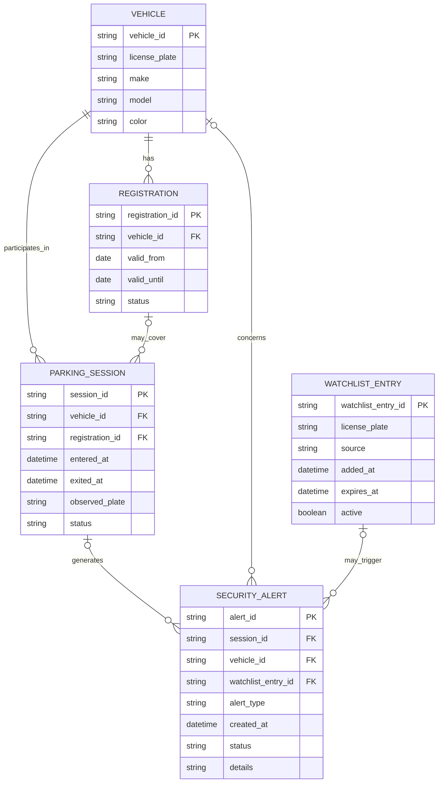

# SmartPark Sentinel — AI First Domain Model

## AI Tool
GitHub Copilot in VS Code

## Original AI-Generated ER Diagram

## Original AI Assumptions

A vehicle can have multiple registrations over time and multiple parking sessions. A session may have no linked registration when the vehicle is unregistered or its registration cannot be matched.

`observed_plate` is kept on the session to preserve what the camera detected, including a missing or unreadable plate, while `license_plate` represents the vehicle's stored plate.

Alerts can lack a vehicle, session, or watchlist match when detection is incomplete or the alert has another cause.

A watchlist entry may trigger multiple alerts; its plate and source are stored independently of the vehicle record.
