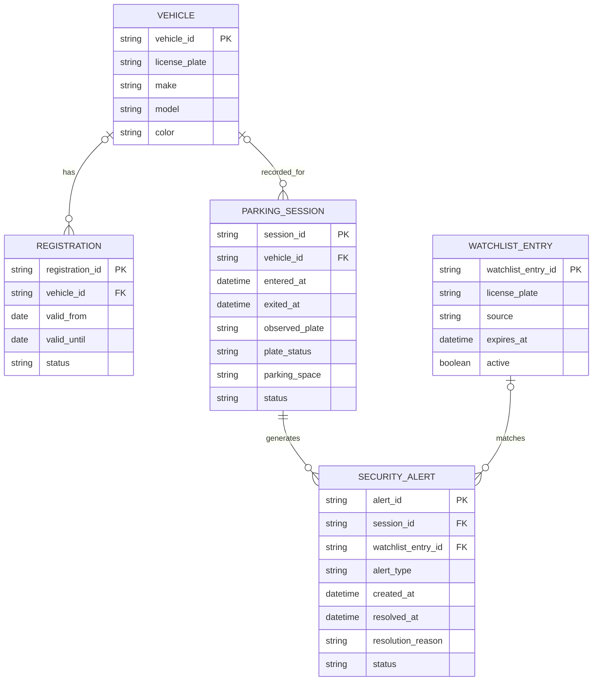

# SmartPark Sentinel — My Domain Model

## Mermaid ER Diagram

## Design Explanation

This model focuses on the main information needed
for SmartPark Sentinel.

1. VEHICLE stores the identity and basic details
   of a known vehicle.

2. REGISTRATION stores parking authorization
   information. A vehicle may have more than
   one registration over time.

3. PARKING_SESSION records entry and exit times.
   It can exist without a known vehicle because
   missing or unreadable license plates are
   part of the project requirements.

4. WATCHLIST_ENTRY stores simulated or authorized
   watchlist records used to check possible
   stolen-vehicle matches.

5. SECURITY_ALERT stores parking warnings,
   missing-plate alerts, watchlist alerts,
   and their resolution information.

## Design Decisions

- I kept five main entities rather than adding
  separate User, Role, Permission, and Settings
  tables to the initial domain model.

- I removed the direct Vehicle-to-SecurityAlert
  relationship from the AI draft. Alerts are
  connected through parking sessions instead.

- I removed the Registration-to-ParkingSession
  relationship to avoid storing an extra link
  before the registration workflow is defined.

- I added plate_status to distinguish missing,
  unreadable, and readable license plates.

- I added parking_space to support identifying
  vehicles remaining in the same space.

- I added resolved_at and resolution_reason
  to support reviewing and resolving alerts.

## Requirements Traceability

- US-01: VEHICLE and REGISTRATION
- US-02: PARKING_SESSION
- US-03: PARKING_SESSION and SECURITY_ALERT
- US-04: PARKING_SESSION and SECURITY_ALERT
- US-05: WATCHLIST_ENTRY and SECURITY_ALERT
- US-06: VEHICLE and REGISTRATION
- US-07: PARKING_SESSION and SECURITY_ALERT
- US-08: SECURITY_ALERT

## Scope Limitations

This is a proposed initial domain model, not a
completed database implementation.

Parking-space information records a reported
location, but does not by itself prove a vehicle
has remained physically stationary for 30 days.

Manual inspections or repeated camera observations
would be required to verify physical movement.

Staff authentication, staff attribution, and
detailed access controls will need refinement
before the security features are deployed.
